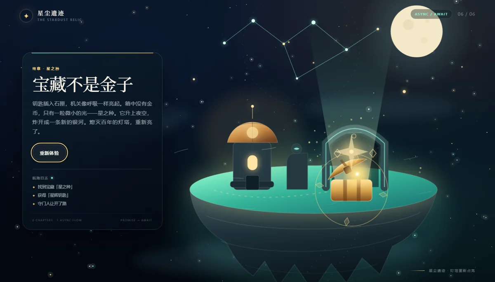

# 全栈开发

> GitHub 仓库名使用拼音 `quanzhan-kaifa`（平台不接受中文仓库名），项目名称仍为「全栈开发」。

本仓库用于存放全栈开发课程实验成果。

## 实验三：星尘遗迹 · 异步寻宝



用 `async/await` 驱动的互动式寻宝动画：机械萤火虫「小烛」带着缺角的星图，穿越风之回廊、唤醒石像守门人、取得月影湖的钥匙，最终找到「星之种」。

- 在线体验：<https://asuka060108.github.io/quanzhan-kaifa/>
- 项目源码：[exp3](./exp3/)
- 项目说明：[exp3/README.md](./exp3/README.md)

### 技术要点

- `async/await` 串联 6 个异步寻宝章节
- SVG 场景分章点亮：星座、观星台、风、神庙、宝箱
- Canvas 星空、流星与结局金色粒子
- 机械萤火虫沿 SVG 路径移动
- 打字机剧情、进度条、航海日志
- 响应式布局，无第三方依赖

### 目录

```text
.
└── exp3/
    ├── index.html
    ├── style.css
    ├── treasure-async.js
    ├── app.js
    ├── treasure.js
    ├── preview.webp
    └── README.md
```

## 本地运行

```bash
cd exp3
python -m http.server 8000
```

访问 <http://localhost:8000/>。

也可以直接双击 `exp3/index.html` 打开。
