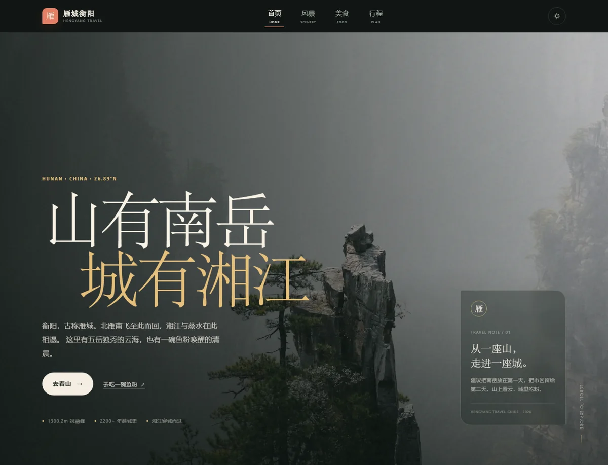
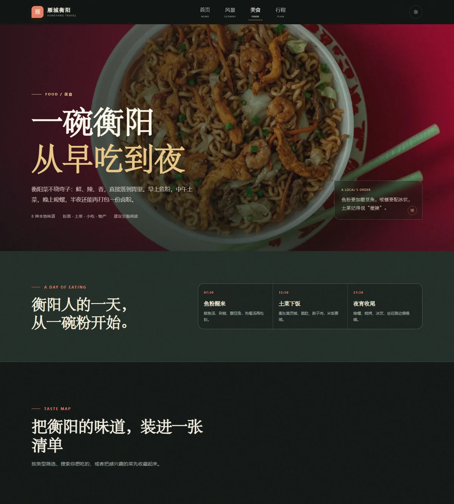
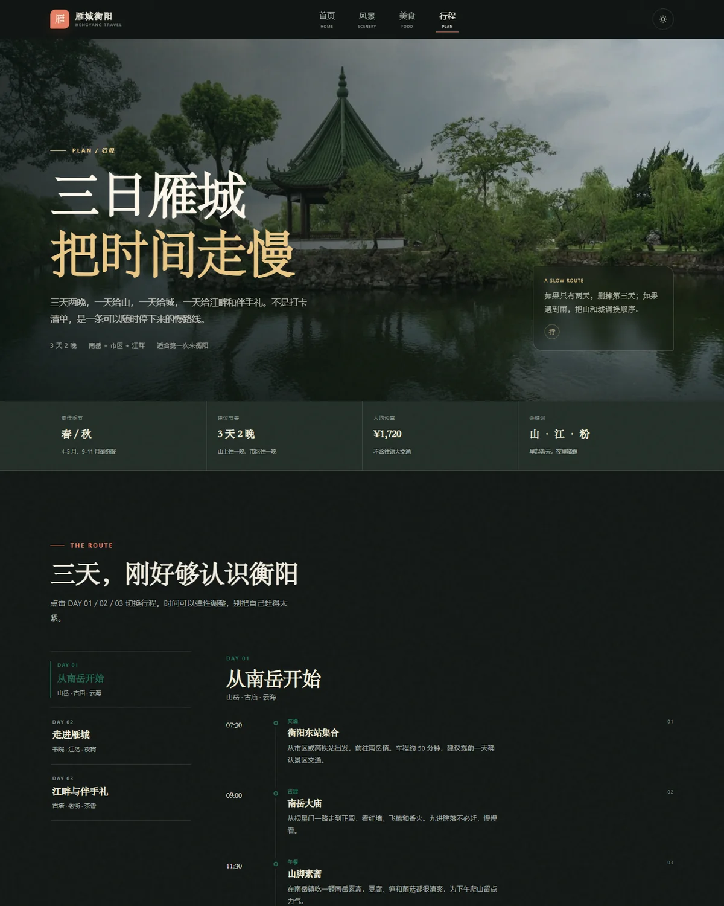

# 雁城衡阳 · 全栈版

在 `exp4` 衡阳旅行 Vue 3 前端的基础上加入 **Express API**，形成：

```text
Vue 3 + Vite 前端（client）
        ↓  /api 请求
Express 后端（server）
        ↓
JSON 数据 + 图片 + favorites.json
```

前端不再直接 import 景点/美食/行程数据，而是通过 `fetch` 调用 Express 接口。收藏也从浏览器 `localStorage` 迁移到后端，按匿名 `X-Client-Id` 隔离保存。



## 页面

| 风景 | 美食 | 行程 |
| --- | --- | --- |
|  |  |  |

## 目录

```text
exp6/
├── client/                 # Vue 3 + Vite 前端（来自 exp4）
│   ├── src/
│   │   ├── api.js          # fetch 封装、X-Client-Id
│   │   ├── composables/    # useFavorites 改为 REST
│   │   ├── views/          # 四个页面改为从 API 取数
│   │   └── components/     # 原有展示组件
│   ├── vite.config.js      # /api、/images 开发代理
│   └── package.json
├── server/                 # Express 后端
│   ├── src/
│   │   ├── index.js        # 路由、静态资源、SPA 回退
│   │   └── data/           # 景点、美食、行程种子数据
│   ├── public/images/      # 由后端托管的图片
│   ├── data/favorites.json # 运行时收藏数据（自动生成）
│   └── package.json
├── docs/screenshots/
├── scripts/
│   ├── dev.mjs             # 同时启动 server + client
│   └── build.mjs           # 构建 client
├── package.json
└── pnpm-workspace.yaml
```

## 启动

```bash
cd exp6
pnpm install
pnpm dev
```

- 前端：<http://localhost:5173>
- API：<http://localhost:3000/api/health>

`pnpm dev` 会同时启动 Express（3000）和 Vite（5173），Vite 把 `/api`、`/images` 代理到 Express。

也可以分开启动：

```bash
pnpm dev:server
# 新终端
cd client && pnpm dev
```

## 生产构建

```bash
pnpm build
pnpm start
```

`pnpm build` 输出 `client/dist`；`pnpm start` 由 Express 同时提供 API、图片和前端静态文件：

```text
http://localhost:3000/
```

生产模式下前端和 API 同源，不需要 Vite 代理。

## API

| 方法 | 路径 | 说明 |
| --- | --- | --- |
| GET | `/api/health` | 健康检查 |
| GET | `/api/home` | 首页统计、精选景点/美食、行程、提示 |
| GET | `/api/attractions` | 景点列表，支持 `category`、`q`、`sort` |
| GET | `/api/attractions/categories` | 景点分类 |
| GET | `/api/attractions/:id` | 景点详情 |
| GET | `/api/foods` | 美食列表，支持 `category`、`q`、`sort` |
| GET | `/api/foods/categories` | 美食分类 |
| GET | `/api/foods/:id` | 美食详情 |
| GET | `/api/itinerary` | 三日行程、行前清单、旅行提示 |
| GET | `/api/config` | 预算方式、门票、交通信息 |
| GET | `/api/favorites` | 当前 client 的收藏 |
| POST | `/api/favorites/:id` | 添加收藏 |
| DELETE | `/api/favorites/:id` | 取消收藏 |
| DELETE | `/api/favorites` | 清空收藏 |

示例：

```bash
curl http://localhost:3000/api/attractions?category=山岳&sort=rating
curl http://localhost:3000/api/foods?q=鱼粉
curl -H "X-Client-Id: demo-client-0001" http://localhost:3000/api/favorites
curl -X POST -H "X-Client-Id: demo-client-0001" http://localhost:3000/api/favorites/fish-noodles
```

## 后端设计

- `express.json()` 解析 JSON 请求体；
- `cors` 允许开发地址和 `X-Client-Id`；
- 景点/美食/行程数据放在 `server/src/data`，图片由 `/images` 托管；
- `favorites.json` 持久化匿名收藏，写入时按 client id 隔离；
- 生产环境 `express.static(client/dist)` 托管构建产物，非 `/api` 的 GET 请求回退到 `index.html`，支持 Vue Router history 路由；
- 统一的 `{ ok, data }` / `{ ok, message }` 响应格式；
- API 404 和 500 错误处理。

## 前端改动

- 新增 `src/api.js`：统一 `fetch`、JSON 解析、错误处理、`X-Client-Id`；
- `useFavorites` 从 localStorage 改为 `GET/POST/DELETE /api/favorites`；
- `HomeView` 从 `/api/home` 取数；
- `SceneryView` 从 `/api/attractions` 取景点与分类；
- `FoodView` 从 `/api/foods` 取美食与分类，收藏走 API；
- `PlanView` 从 `/api/itinerary` 取行程/清单/提示，从 `/api/config` 取交通信息；
- 行程清单勾选状态仍保存在本机 `localStorage`（属于个人偏好，不必上云）；
- 页面加载失败时显示 API 连接提示。

## 技术栈

| 层 | 技术 |
| --- | --- |
| 前端 | Vue 3.5、Vue Router 4、Vite 7 |
| 后端 | Node.js、Express 4、cors |
| 数据 | 静态 JSON/JS 种子数据 + `favorites.json` |
| 开发 | `node --watch` + Vite HMR |

## 说明

这是课程实验用的轻量全栈版本：

- 没有登录系统，收藏用匿名 client id 区分；
- 没有数据库，收藏写入 JSON 文件；
- 生产部署只需 Node 环境，前端构建产物由 Express 托管；
- 如果要继续扩展，可把 `favorites.json` 替换为 SQLite/MySQL，并增加登录、订单、评论等接口。
